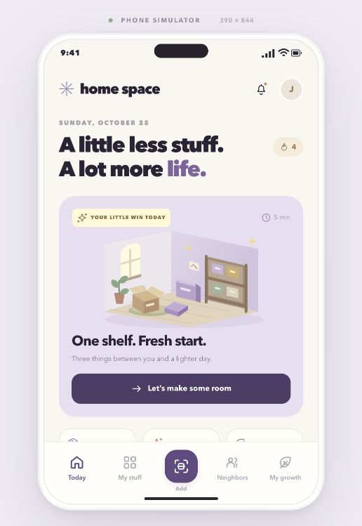

# Home Space

Make space for living. A mobile-first decluttering hackathon demo that helps people find what they own, decide what to keep, and give useful things a new home.

## Run the demo

Use a modern Node.js runtime. The demo was tested with Node.js 24.7.0 and has no external package dependencies.

```sh
git clone https://github.com/jherreria/home-space.git
cd home-space/demo
npm start
```

Open **http://localhost:4173**. No installation step, account, API key, or credentials are required. Keep the server running while presenting; stop it with **Control-C**.

The desktop view includes an interactive phone simulator and journey shortcuts. On a phone-sized screen, the app fills the viewport. This is a browser app; a native mobile build is not included.

## Explore the demo

- **One shelf, three decisions:** keep, donate, trade, or defer items and earn points and a collectible.
- **Find an item's next chapter:** try simulated recognition, an estimated value, related-item storage suggestions, and neighborhood demand.
- **Remember your belongings:** search inventory, move items, and explore a sample home map.
- **Connect with neighbors:** create a wanted request, offer an item, exchange demo messages, and confirm a handoff.
- **Document your home:** download a household inventory PDF or CSV and explore a separate valuables vault.

Progress stays in this browser. Use **Reset demo**, or **My growth → Settings → Reset this demo**, to start another presentation.



## Prototype scope

Navigation, inventory changes, local progress, and PDF/CSV downloads work. Recognition, valuations, neighbors, matches, floor-plan lookup, and conversations use fictional sample data. The vault is a visual demonstration without production authentication or encryption. There are no external marketplace posts, payments, push notifications, or cloud backups.

The experience uses small missions, visible progress, surprise keepsakes, and friendly community recognition. Completing a sprint provides a stopping point, and taking a break does not remove earned progress.

## Project files

- [Product requirements and MVP scope](Home-Stuff-PRD.md)
- [Presentation walkthrough and demo details](demo/DEMO-GUIDE.md)
- `demo/app.js` — screens, local state, interactions, and export generation
- `demo/data.js` — fictional inventory and community records
- `demo/assets.js` — original SVG illustrations and icons
- `demo/styles.css` and `demo/details.css` — responsive styling
- `demo/server.mjs` — development server

The PRD retains its original filename so existing links remain valid; its product name is Home Space.

## Check the code

From the repository root:

```sh
npm run check --prefix demo
```

This checks JavaScript syntax. The demo guide records the browser walkthroughs and export checks completed during development.

## License

See the repository's [Apache 2.0 license](LICENSE).
